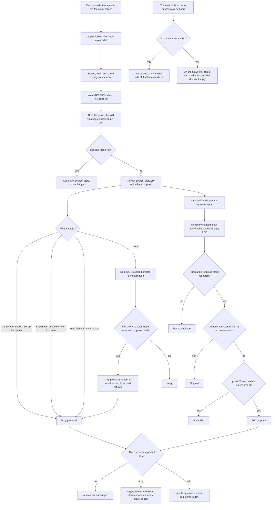

# Screeny

On-demand stock-article scout. It sweeps Substack and a short list of blogs, forums, Value Investors Club, and Seeking Alpha, reads pitches in full, scores them out of 6, and writes a ranked Markdown report.

The user runs it from the Cursor agent window. A run starts when someone asks. Nothing runs on a timer. The Seeking Alpha Long Ideas pull is the only step that uses a signed-in browser. No password or cookie is stored in the repo.

## Setup

```bash
python3 -m venv .venv
source .venv/bin/activate
pip install -r requirements.txt
```

Commands assume the repo root. Scripts find `config/`, `state/`, and `reports/` from their own location.

Optional: set `SCREENY_USER_AGENT` if you want a specific User-Agent. The default is a plain browser string. Do not put an email address in the repo.

Markdown is the report. The PDF is that same file, including **Articles from top-record authors**. Install the optional packages, then pass `--pdf`:

```bash
pip install markdown weasyprint
python3 scripts/make_report.py --pdf
```

That writes `REPORT.pdf` next to `REPORT.md`. If those packages are missing, the script keeps the Markdown and prints that the PDF was skipped.

## Ask Cursor

- `Run the stock screen`
- `Screen this week's articles`
- `Screen articles since 2026-10-01`
- `What is this author's batting average?`

The agent follows `AGENTS.md` and `.cursor/skills/`. A full run covers the last 4 months. "This week" means the last 7 days.

## Layout

| Path | Role |
|---|---|
| `config/sources.csv` | Active sources (Substack plus a few manual feeds) |
| `config/sources_dormant_or_dead.csv` | Parked feeds, including sources that were already dormant or dead. Automatic adds skip them. A dormant recheck may put a parked author back unless they are also on the never-readd list |
| `config/sources_dropped_never_readd.csv` | Authors removed by an approved drop (`name`, `url`, `dropped_on`, `reason`). Currently the 17 drops from 2026-10-16. Discovery skips them. `--apply` refuses the add. A dormant recheck must not put them back |
| `config/universe.csv` | Optional ticker list for earnings-drop search |
| `state/seen_posts.csv` | URLs already swept. Dedupe key is `url`. Append-only |
| `state/source_stats.csv` | Per-source upkeep stats. Seeking Alpha is excluded |
| `state/scored.json`, `state/batting.json` | This run's scores and batting averages |
| `state/sa_breakdown.json` | Seeking Alpha counts actually observed this run |
| `state/sa_results.json` | Seeking Alpha article ids already checked or merged. Gitignored |
| `reports/` | Dated reports and upkeep proposals. Sample: `reports/2026-10-14/` |
| `examples/` | Same sample, plus `scored.json` so the report script can re-render it |
| `fulltext/`, `cache/` | Local fetches, including pitch bodies and `cache/crawl.json`. Gitignored |
| `scripts/` | Sweep, fetch, prices, earnings drops, report, source upkeep |
| `rerun/` | Full 4-month rebuild helpers |
| `bat/` | Author batting average: detection, exclusion, prices, and the chance calculation |
| `.cursor/skills/stock-screen/` | Sweep, triage, read, score, report, then upkeep |
| `.cursor/skills/author-batting-average/` | Batting average on its own |

`bat/` files:

| File | Role |
|---|---|
| `bat/pitches.py` | Detect one author's pitches, or write `bat/pitches.json` from the hand list |
| `bat/lib.py` | Archive, title and body detection, parallel fetch, `.TO`/`.V` price retry, 2-year score |
| `bat/longcheck.py` | Drop a short, a sell, or a hold whose body does not show ownership |
| `bat/calc.py` | Windows, `p_lt_hits`, and `state/batting.json` for the report |
| `bat/sa_one.py`, `bat/sa.py` | Seeking Alpha public author history (title, date, ticker, sentiment) |
| `bat/prices.py`, `bat/arch.py` | Price and archive helpers |

## Commands

```bash
python3 scripts/weekly_sweep.py --since 2026-10-08
python3 scripts/earnings_drops.py
python3 scripts/rss.py FEED_URL --since 2026-10-08
python3 scripts/grab_fulltext.py reports/triage_YYYY-MM-DD.json
python3 scripts/px.py 2026-10-01 AAPL
python3 scripts/sa_ingest.py screen reports/sa_list_YYYY-MM-DD.csv
python3 scripts/sa_ingest.py check fulltext/sa_ID.txt
python3 scripts/sa_ingest.py merge reports/sa_candidates_YYYY-MM-DD.csv reports/triage_YYYY-MM-DD.json
python3 scripts/sa_ingest.py self-test
python3 scripts/sa_public.py article https://seekingalpha.com/article/123
python3 bat/sa_one.py "Author Name" author-slug
python3 bat/pitches.py subdomain --limit 20
python3 bat/calc.py
python3 scripts/make_report.py --prices --pdf
python3 scripts/make_report.py --example --pdf
python3 scripts/crawl_sources.py
python3 scripts/source_upkeep.py --plan
python3 scripts/source_upkeep.py --plan --crawl
python3 scripts/source_upkeep.py --plan --full-ba
python3 scripts/source_upkeep.py --apply reports/source_upkeep_YYYY-MM-DD.json
```

`make_report.py --example` re-renders the 2026-10-14 sample from `examples/scored.json` into `cache/example-REPORT.md`. It does not call the network.

Triage files are JSON. `grab_fulltext.py` reads that file directly.

`weekly_sweep.py` drops a free post on the title only when it is a recap, a macro note, or a list. The match is on whole words. It does not drop a post because the title lacks a pitch keyword. Each remaining free post is fetched (the first 1,500 words) and dropped only when the body is clearly not a single-stock pitch (macro, book review, general essay, multi-stock list, or no identifiable listed company), or the author is short, selling, or on hold. Anything unclear stays a candidate. Paywalled posts are dropped. Every post in the window, including those drops, is written to `reports/substack_screen_<date>.csv` with `url`, `title`, `decision`, and `reason`. Drop counts in `reports/stats_<date>.json` are counted from that file. `make_report.py` uses the same file when the scored stats include `substack_screen`. Posts already in `state/seen_posts.csv` are not fetched again.

A full 4-month rebuild, when asked, is `python3 scripts/rerun_sweep.py`, then `rerun/fetch.py`, `rerun/screen1.py`, `rerun/resolve.py`, a full read recorded in `rerun/dispo.py`, then `python3 scripts/make_report.py --legacy`.

## Source list

The active list is `config/sources.csv`. The sweep and the report read that file. They do not run `--plan`. There is no timer. When the agent follows the stock-screen skill, it writes the report and then runs `python3 scripts/source_upkeep.py --plan`. That refreshes `state/source_stats.csv` and writes a proposal. It does not change the source lists. `--apply` changes them only for proposals the user marks `"approved": true`.



A blank last-post date is not a stale drop, and there is no probation. The `p > 0.23` and median-excess test is only for an automatic add proposal. `p` is `ba2y_p_lt_hits`: binomial `P(X <= hits - 1)` with `n` equal to the 2-year pitch count and success probability 0.5, rounded to 4 decimals. `median_excess_2y` is `ba2y_median_excess`, the median of stock return minus benchmark return in that window. Median stock return for that same window is stored as `ba2y_med_ret`. The three publications added on 2026-10-16 were hand-adds: that bar does not apply to them, and none is on the never-readd list. Automatic adds also skip authors who are only on the dormant list. A dormant recheck may put those authors back. It must not put a never-readd author back.

## Source upkeep

`python3 scripts/source_upkeep.py --plan` rewrites `state/source_stats.csv` and writes `reports/source_upkeep_<date>.json`. It leaves `config/sources.csv`, `config/sources_dormant_or_dead.csv`, and `config/sources_dropped_never_readd.csv` unchanged. It does not recompute every batting average.

Every drop and every add is a proposal. Show the user each line with the source name, whether it is a drop or an add, the reason, the numbers behind it, `p_lt_hits_by_chance`, and `ba_updated` (the date that batting average was calculated). Set `"approved": true` only on the entries the user approves, then:

```bash
python3 scripts/source_upkeep.py --apply reports/source_upkeep_YYYY-MM-DD.json
```

`--apply` changes the lists only for those approved entries. Unapproved entries stay proposals. An approved drop moves the row to `config/sources_dormant_or_dead.csv` and appends `name`, `url`, `dropped_on`, and `reason` to `config/sources_dropped_never_readd.csv`. An approved add appends a Substack row to `config/sources.csv` and writes the batting average computed for that candidate into `state/source_stats.csv`. The next report picks the new author up from that file.

### When a source is proposed for removal

Tracked active sources have a soft cap of 600. Seeking Alpha rows are not in that count.

Propose a drop only in these cases:

- The 2-year batting average is 33% or less on at least 5 pitches. The cutoff is a fraction under 0.334, so a one-third record is included.
- The last known post is older than 6 months. A blank last-post date is unknown and stays.
- The feed failed to load on 4 consecutive runs. A run counts only when `weekly_sweep.py` recorded that source in its stats file (`attempted` and `failed`). The fourth failure is enough. There is no probation period.

A source with no scored articles stays. Empty output is not a removal reason.

The cap trim runs only when the list, after those drops and after counting proposed adds, would still exceed 600. It proposes the lowest 6-month average score, and only among sources with at least 3 scored articles in that window, until the list fits.

### When a source is proposed for addition

An add is a Substack recommendation of an author who scored at least 4.5/6, and only when the candidate's `p` is greater than 0.23 and `median_excess_2y` is greater than 0. A missing `p` or a missing median excess does not pass. A candidate who fails either test is recorded as not added.

`p` is `ba2y_p_lt_hits`. `bat/calc.py` `p_lt_hits` computes the binomial probability `P(X <= hits - 1)` with `n` equal to the number of 2-year pitches and a success probability of 0.5, then rounds to 4 decimals. It is the chance of fewer hits than this author got if each pitch were a coin flip. It is 0 when hits is 0, and blank when `n` is missing. The same formula is described under **p_lt_hits_by_chance**. For 1 hit out of 2, `p` is 0.25. For 2 hits out of 2, it is 0.75.

`median_excess_2y` is stored as `ba2y_median_excess`. It is the median of each 2-year pitch's stock total return minus its benchmark total return. The window is pitches published 2–3 years ago. The benchmark is XIC.TO for `.TO` and `.V`, and SPY otherwise. The stored number is a fraction, so 0.05 is 5 percentage points. Greater than 0 means the median pitch beat its benchmark.

Median stock return for that same window is stored as `ba2y_med_ret`. `bat/lib.py` `score()` returns it as `median_return`: the median of the stock total returns, before subtracting the benchmark. It is a fraction, blank when there are no priced pitches.

`--crawl` fetches those recommendations (the same walk as `scripts/crawl_sources.py`). Without it, `--plan` uses `cache/crawl.json` when that file exists.

While evaluating new authors, a recommendation is kept only when the publication name or description reads as stock research (small-cap, value, equity, thesis, and similar wording). Publications about crypto, bitcoin, forex, options trading, day trading, real estate, macro-only, or politics are skipped and are not add candidates.

Seeking Alpha is one pull for the run, not a tracked source, and those articles are not added to `state/seen_posts.csv`. It is left out of `state/source_stats.csv`. The pull uses the machine's signed-in browser: save the Long Ideas list, run `scripts/sa_ingest.py screen`, read each candidate into `fulltext/sa_<id>.txt`, then `check` and `merge`. The cheap screen uses the reference recap, multi-stock, and fund patterns, then Yahoo for listing and market cap. If the session has expired, ask the user to sign in. Do not request or store a password or a cookie. A preview or a missing long disclosure is not scored. A disclosed long in another listing of the same company, confirmed by the base symbol or the Yahoo company name, still counts. A bond, preferred, or note of that issuer is `long_other_security` and is listed in the report appendix for the user to judge. A disclosure that names only unrelated tickers stays `author not long`. A bot check is tried once more, then the pull stops. The unread remainder is `reports/sa_read_order_<date>.csv`; `sa_ingest.py resume` continues it. Yahoo quotes use a public crumb and fall back to the chart API. A quote fetch that misses more than 30% of symbols stops instead of marking every name not found. Market cap for names between US$3B and US$40B is scaled to the publish-day price. `--apply` skips a Seeking Alpha row. The sweep's `sourced` count is every post in the window. `new_since_last_run` is the subset not already in `state/seen_posts.csv`. X-linked blogs are included only when the user pastes the links, so the original run's two `x_network_blog` posts are not in the repo count. Caveat lines for prices and CEO stakes come from `state/run_notes.json` (`price_source`, `ceo_stake_source`, `sa_pull_complete`). The default CEO source is the article only.

### Never re-add

`config/sources_dropped_never_readd.csv` holds authors removed by an approved drop. It currently has the 17 drops from 2026-10-16. Discovery treats those URLs and Substack subdomains as already known and skips them. `--apply` prints `REFUSED` and does not add anyone on the list. A dormant recheck must not move that author back to `config/sources.csv`. The only override is a hand edit of the never-readd file.

Authors who are only parked in `config/sources_dormant_or_dead.csv` are not on that list. Automatic adds skip them because the dormant list is already known. A dormant recheck may put them back.

### Manual-add exception

The automatic add bar is `p > 0.23` and `median_excess_2y > 0`. The user can still approve a source by hand. On 2026-10-16 three publications were added that way. Each row's `how_discovered` records the exception. None of the three is on the never-readd list. Each is `type=substack`, `status=active`, with `feed_url` set to `<url>/feed`. The batting averages below are seeded with `ba_updated=2026-10-16` and `ba_method=v2-excl-TO`.

| Source | URL | 2y BA | p_lt_hits_by_chance |
|---|---|---|---|
| Intrinsic Value System | https://intrinsicvaluesystem.substack.com | 15/31 | 0.3601 |
| Welfare Capital Research | https://welfarecapital.substack.com | 2/2 | 0.75 |
| The Lead-Lag Report | https://leadlagreport.substack.com | 2/2 | 0.75 |

For the two 2/2 sources, 0.75 is `P(X <= 1)`. This exception covers how they were added. Later removal proposals still use the drop rules above.

### What each tracked source stores

Seeking Alpha is excluded. Every other active source records:

- last post date
- consecutive failed loads
- articles scored in the last 6 months, and the average score over those articles
- 2-year batting average (`ba2y_hits`, `ba2y_n`, `ba2y_pct`, and `ba_2y` as a percent)
- `ba2y_p_lt_hits`, which is `p_lt_hits_by_chance`
- `ba2y_median_excess`, which is `median_excess_2y`
- `ba2y_med_ret`, which is the median stock return over the same 2-year pitches
- `ba_updated` and `ba_method` (the current method is `v2-excl-TO`)
- title versus body pitch counts (`ba2y_n_title`, `ba2y_n_body`, also mirrored on `pitches_title` and `pitches_body`)
- `ba2y_excl` (short, sell, and hold counts) and `ba2y_lost_px` versus `ba2y_lost_notfound`

`pitches_title` and `pitches_body` stay blank until that author has been detected. A blank percentage is neither a drop nor an add.

## Batting average

The 2-year average used for upkeep is separate from the /6 score. The /6 score still requires an explicit long disclosure. The batting average answers a different question: of the author's past pitches, how many beat the benchmark.

### Window and sample

One pitch per ticker. Inside a window, the earliest pitch on that ticker is the one that counts.

- **2-year (stored for upkeep and used for drops and adds):** published 2–3 years before today. Measure the 24-month total return from the publish-date close.
- **1-year (report only):** published 1–2 years before today. Measure the 12-month total return.

`bat/calc.py` sets both windows from today's date. A sample under 5 pitches is flagged as small and does not rank in the report's top-5 tables. No pitches in a window is `n/a`.

### How a pitch is detected

`python3 bat/pitches.py subdomain` reads the public archive.

- A title that names exactly one US or Canada ticker is method `title`. A dual listing such as `(TSXV: SUM or OTC: SUMMF)` is one company. The batting-average title parser maps both TSX and TSXV to `.TO`. `(TYO: 7974)` and other non-US/Canada tags are dropped.
- No ticker, or more than one company: fetch `https://<host>/api/v1/posts/<slug>`, cached under `cache/` (gitignored). Method `body`. The ticker comes from the opening text and from repeated mentions (`$TICKER`, `(NYSE: X)`, `(TSX: X)`, `ticker: X`). If none appear, the company name is looked up on Yahoo (US/Canada equity only). A holding-company title is not replaced by a subsidiary ticker.
- The 2-year pass fetches the body even when the title already names the ticker, so a hold or short in the body is visible. Bodies for the 1–3 year window are fetched in parallel. Each HTTP call has a hard wall-clock cap. One author has about a 300 second budget. A partial result past that budget is not saved.
- For the /6 score, the author must disclose a long: an explicit "I own / I am long / my position" line, or buy/thesis language. "May hold" does not count.
- Each kept pitch stores `method` (`title` or `body`) and `confidence`. A preview body is not mined for a ticker. Seeking Alpha past pitches use the public author API only.

### What is excluded

`bat/longcheck.py` `exclude_reason` drops a short, a sell rating, or a hold rating. A hold stays in when `is_long` on the post body is `long` (the author clearly owns the shares). Ownership in the title alone does not override a hold. A pitch with no short, sell, or hold signal still counts, including an unclear stance. Counts by reason are stored in `ba2y_excl`.

### Prices and benchmarks

Prices use Yahoo's chart API (adjusted close, dividends included). A timeout is retried and is never cached, and it is not a delisting (`ba2y_lost_px`). Only a real Not Found is cached, for 7 days (`ba2y_lost_notfound`). A symbol with no dot and no listing is retried as `SYM.TO`, then `SYM.V`. A timeout stops that suffix retry.

The batting-average benchmark is XIC.TO for `.TO` and `.V`, and SPY otherwise. `.CN` and `.NE` use SPY on this path. The report's "since publish" column is a different comparison: IWM for US listings and XIC.TO for Canada (`.TO`, `.V`, `.CN`).

A hit is a pitch whose total return beat its benchmark. The batting average is hits / pitches evaluated. Always show hits/total and the percent. Delisted or acquired stocks use the buyout price or the last trade. If the outcome cannot be found, the pitch is excluded and the reason is noted. Known buyouts live in the `BUY` map in `bat/calc.py`.

### p_lt_hits_by_chance

`p_lt_hits_by_chance` is the binomial probability `P(X <= hits - 1)` with `n` pitches and `p = 0.5`: the chance of fewer hits than this author got if each pitch were a coin flip. `bat/calc.py` `p_lt_hits` computes it and rounds to 4 decimals. It is 0 when hits is 0, and blank when `n` is missing.

It is always stored, in `state/source_stats.csv` as `ba2y_p_lt_hits` and in `state/batting.json` as `p_lt`. Every upkeep proposal prints it next to `ba_updated`. The plan's stored-average list and the report's top-5 batting tables sort by it, highest first. For 2 hits out of 2 the value is 0.75. For 15 hits out of 31 it is 0.3601.

### When a stored average is recalculated

A stored batting average has no expiry. `--plan` keeps the stored numbers and recalculates only in two cases, and only when `ba_updated` is not today:

- the author is proposed for removal
- the author is an add candidate

`python3 scripts/source_upkeep.py --plan --full-ba` is the one-off pass over every Substack author. It skips authors already stored with `ba_method=v2-excl-TO`, saves every 10 authors, and resumes. `--force` redoes authors already stored with the current method. `--ba-limit N` stops early. If an author's time budget runs out, that partial average is not saved. Recomputing an author can change a number if the archive or prices have moved.

## Report

`python3 scripts/make_report.py` writes `reports/<today>/REPORT.md`. `python3 scripts/make_report.py --pdf` writes `REPORT.pdf` from that Markdown. After the ranked list, the batting tables, and the next six, both files have **Articles from top-record authors**.

That section lists every article published inside the report window by an author whose stored 2-year record has at least 2 pitches and `ba2y_p_lt_hits` of 0.5 or higher. The author list is read from `state/source_stats.csv` at report time and limited to URLs still in `config/sources.csv`. An article is matched to that author by URL. Authors who are only in the stats file, or only on the dormant or never-readd lists, are not included. Next to each author: hits/pitches, the batting average, and `p_lt_hits_by_chance`. Each article shows the date, title, link, and the /6 score when that article was scored. Authors are ordered by that chance, highest first. An approved add is included on the next report because `--apply` stores the recomputed batting average.

## Coming

The 1-year median stock return and the 1-year median excess return are not stored yet. The 2-year median stock return is stored as `ba2y_med_ret`. The 2-year median excess is stored as `ba2y_median_excess` and is part of the automatic add bar. The screen report already prints median excess return for authors computed during a run.

## Rules that do not change

Cite every source. Never invent a number or a URL. Score only articles read in full. Do not bypass paywalls or bot checks. Never use Seeking Alpha investing groups. If Seeking Alpha shows a bot check, stop and score what was already read. The author has to disclose a long position. X links are optional and are pasted by hand. This repo does not call the X MCP.
