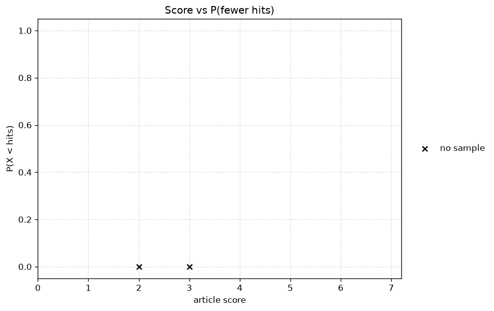

# Stock article scout: ranked report

Window: articles published 2026-10-11 to 2026-10-18. Generated 2026-10-19.

## Stats

- **Articles sourced (posts in window):** 356
- **New since last run:** 231
- **Articles read in full:** 24
- **Articles scored:** 2

## 1. Screening

A post must be: free to read in full (paywalled or preview-only posts are dropped); a single-stock bullish pitch (updates and earnings reviews count); on a small/mid-cap company; listed in the US or Canada; and the author must disclose holding a long position (a Seeking Alpha "beneficial long position" disclosure, or an explicit "I own / I am long / I hold a position" statement; "may hold" boilerplate does not count). Any length qualifies. Lacking a moat or an edge is not a drop.

## 2. Reported, not scored

Fact-check of key claims, author batting average (share of past long pitches that beat IWM, or XCS.TO for .TO and .V listings, over 1-year and 2-year windows; see the Author batting average skill), management guidance record, balance-sheet flags, and soft notes. Shown per name; they do not change the score.

## 3. Scoring (out of 7, 1 point each)

1. **Thesis with secular runway**: cheap with no growth = 0.5.
2. **Return ~40%/yr**: from the publish-day close to the author's target over the author's timeframe (2 years if none given). 25-40%/yr = 0.5; under 25%/yr = 0.
3. **CEO ownership or incentive** (highest tier: CEO or founder-CEO at least 5% = 1; CEO or executive-chair open-market purchase = 0.75; 1–5%, a stated holding not shown to be under 1%, skin in the game, or a non-CEO founder or chair at least 5% = 0.5; aggregate insiders at least 10%, a director or unnamed insider purchase, or pay tied to performance = 0.25; otherwise 0, and 'not stated' when nothing is in the article or a cited filing).
4. **Moat**: five moat types, Strong 1 / Moderate 0.75 / Narrow 0.5; none described = 0.
5. **Edge**: checkable evidence about the people, Strong 1 / Moderate 0.75 / Narrow 0.5; assertion only = 0.
6. **Differential view**: names why the market is wrong (stigma or label, temporary or mundane issue, neglect) and why it corrects; an overreaction to temporary news supports it.
7. **Dated catalyst within ~24 months**: undated = 0.5.

A score stored on the old six-point rubric is marked /6. On that rubric criterion 4 is moat, edge is 0, and the old criteria 5 and 6 are shown as 6 and 7.

Ranking: best article per ticker; top 15 plus all ties at 15th (cut = 2), ties alphabetical.

## Ranked list

| # | Ticker | Score | Article | Source | Published | BA 2y (1y) | Below full credit | Since publish vs benchmark |
|---|---|---|---|---|---|---|---|---|
| 1 | BPC.CN | 3/7 | [Precision Peptide: Needle-Free, Four Doors, and What to Watch](https://pennyqueen.substack.com/p/precision-peptide-needle-free-four) | Penny Queen’s Newsletter | 2026-10-15 | n/a | Return ~40%/yr 0; CEO ownership 0; Moat 0; Edge 0.5; Dated catalyst 0.5 | -1.6% vs XIC.TO +0.1% |
| 2 | SFM | 2/7 | [Sprouts Farmers Market (SFM) Investment Thesis](https://theethicalridgetribe.substack.com/p/sprouts-farmers-market-sfm-investment) | The Ethical Ridge Tribe | 2026-10-13 | n/a | Return ~40%/yr 0; CEO ownership 0; Moat 0.5; Edge 0; Differential view 0; Dated catalyst 0.5 | +2.5% vs IWM -2.3% |

### Per-name notes (reported, not scored)

**1. BPC.CN** (3/7): CSE micro-cap peptide interview. The author owns shares bought in the open market. No price target..
- Fact-check: Publish close on 2026-10-15 was 0.315 for BPC.CN (px.py). The Yahoo quote used at screen time put the market cap near 17 million US dollars. The article price of about 30 cents this week matches that close.
- Guidance: No numeric guidance. Management said the company is funded after a small financing and the warrant exercise.
- Balance: The article says the warrants that expired at the end of September were exercised and a financing with fewer than 10 investors has closed. No cash-runway figure is stated.
- Soft: The author bought the shares in the open market and was not paid for the interview.
- Author batting average: 1y n/a; 2y n/a

**2. SFM** (2/7): Organic grocer with store growth and Kroger-like working capital, held for stability rather than a stated re-rating..
- Fact-check: Publish close on 2026-10-13 was 63.60 (px.py). The article average cost is 63.6 and the then-current price is given as 65.14. H1 2026 comparable sales are given as -1.4%, sourced to the Q2 2026 results.
- Guidance: 2026 revenue growth guidance is given as 5.5% to 6.5%, sourced to the Q2 2026 results. No multi-quarter hit rate is stated.
- Balance: SBC is stated as 9.07% of FCF. Working capital is negative because of the cash cycle, which the article treats as retail financing rather than stress.
- Soft: The author is keeping the position for portfolio stability and for the shift toward more responsible grocery practices.
- Author batting average: 1y n/a; 2y n/a

## Score vs P(fewer hits)

Each point is one scored article. The vertical axis is `P(X < hits)` from the author's past pitches, not the batting average itself. Blue is the 2-year sample. Red is the 1-year sample, used only when the 2-year sample is missing. A black x at 0 means neither sample exists.

## Author batting averages (top 5 of the 21)

Measured on past single-stock long pitches only. 1-year window: pitches published 1–2 years ago, 12-month total return vs IWM (XCS.TO for .TO and .V). 2-year window: pitches published 2–3 years ago, 24-month total return. Min 5 pitches to rank; ties alphabetical. Authors with thinner archives show n/a on the one-pagers. Every scored author is calculated; this table is still the top of the ranked list and the next six.

### By 1-year batting average

| # | Author | Hits / N | Avg | P(fewer hits by chance) | Median excess | Best | Worst |
|---|---|---|---|---|---|---|---|
| — | none with ≥5 pitches | | | | | | |

### By 2-year batting average

| # | Author | Hits / N | Avg | P(fewer hits by chance) | Median excess | Best | Worst |
|---|---|---|---|---|---|---|---|
| — | none with ≥5 pitches | | | | | | |

## Next six (ranks 16–21)

| # | Ticker | Score | Article | Source | Below full credit |
|---|---|---|---|---|---|

## Articles from top-record authors

Every article in this window from an author whose stored 2-year record has at least 2 pitches and `p_lt_hits_by_chance` (`ba2y_p_lt_hits`) of 0.5 or higher. The author list is read from `state/source_stats.csv` when the report is written, so it follows the source list. Hits/pitches, batting average, and that chance are shown next to the author. A score is shown only when the article was scored.

### Acid Investments (3/3 = 100%, p_lt 0.875)

| Date | Article | Score |
|---|---|---|
| 2026-10-17 | [Finding footing with (SHOE) after a rocky month](https://acidinvestments.substack.com/p/finding-footing-with-shoe-after-a) |  |

### pettycash (9/13 = 69.2%, p_lt 0.8666)

| Date | Article | Score |
|---|---|---|
| 2026-10-16 | [Stock Picker by Ian Cassel](https://pettycash.substack.com/p/stock-picker-by-ian-cassel) |  |
| 2026-10-13 | [Narratives, Expectations and Reality](https://pettycash.substack.com/p/narratives-expectations-and-reality) |  |

### The Lead-Lag Report (2/2 = 100%, p_lt 0.75)

No articles in this window.

### Welfare Capital Research (2/2 = 100%, p_lt 0.75)

No articles in this window.

### Compounding Quality (3/4 = 75%, p_lt 0.6875)

| Date | Article | Score |
|---|---|---|
| 2026-10-18 | [Best Buys: October 2026](https://www.compoundingquality.net/p/best-buys-october-2026) |  |
| 2026-10-15 | [Position switch](https://www.compoundingquality.net/p/position-switch-688) |  |
| 2026-10-13 | [Back to Our Roots](https://www.compoundingquality.net/p/back-to-our-roots) |  |
| 2026-10-11 | [Adding to Our Portfolio](https://www.compoundingquality.net/p/adding-to-our-portfolio-284) |  |

### Scalper's Lounge (3/4 = 75%, p_lt 0.6875)

| Date | Article | Score |
|---|---|---|
| 2026-10-11 | [RxSight: commercial medtech trading below net cash with a new CEO and new Alcon partnership](https://scalpavelli.substack.com/p/rxsight-commercial-medtech-trading) |  |

### sylencecapital (3/4 = 75%, p_lt 0.6875)

No articles in this window.

### Nugget Capital Partner's Substack (5/8 = 62.5%, p_lt 0.6367)

| Date | Article | Score |
|---|---|---|
| 2026-10-12 | [H&R REIT, an opportunity in a corrupt process](https://nuggetcapitalpartners.substack.com/p/h-and-r-reit-an-opportunity-in-a) |  |

### HFI Research (4/7 = 57.1%, p_lt 0.5)

| Date | Article | Score |
|---|---|---|
| 2026-10-15 | [How High Can Oil Prices Go?](https://www.hfir.com/p/how-high-can-oil-prices-go) |  |
| 2026-10-14 | [(Public) Memo - I Just Don't See How This Ends Well At All](https://www.hfir.com/p/memo-i-just-dont-see-how-this-ends) |  |
| 2026-10-12 | [(Public) Brent Crude Oil Positioning Leaves Me With More Questions Than Answers](https://www.hfir.com/p/public-brent-crude-oil-positioning) |  |
| 2026-10-12 | [(Public) Peak Hormuz](https://www.hfir.com/p/public-peak-hormuz) |  |
| 2026-10-12 | [Here's My Game Plan For The Oil Trade (October 12)](https://www.hfir.com/p/heres-my-game-plan-for-the-oil-trade-0c2) |  |

### Invariant (5/9 = 55.6%, p_lt 0.5)

| Date | Article | Score |
|---|---|---|
| 2026-10-18 | [Outrun](https://invariant.substack.com/p/outrun) |  |
| 2026-10-11 | [Imperial Brands: Collapse](https://invariant.substack.com/p/imperial-brands-collapse) |  |

### Nat Stewart - Stock Picking Newsletter (2/3 = 66.7%, p_lt 0.5)

No articles in this window.

## Caveats

- Prices: px.py Yahoo chart, publish-day close. "Since publish" uses the first close on or after the publish date when a price source was recorded.
- Long-disclosure ambiguous (dropped): EVS (Burn The Index): disclaimer says the author may hold positions.
- CEO stakes: from the article only. If the article and any cited filing do not state the stake, criterion 3 is 0 and the note says not stated.
- Author batting averages use adjusted closes (Yahoo); IWM for US names, XCS.TO for .TO and .V. The since-publish column is a different comparison: IWM for US listings and XIC.TO for Canada. Delisted/acquired names use the buyout or last trade when available; otherwise they are excluded and noted in batting.json. SA author histories used the public author API (title, date, ticker, sentiment); full bodies were not required.
- Value Investors Club's public page now shows ideas only after 90 days (the page's end date was 2026-07-21). The 30 ideas published 2026-07-13 through 2026-07-20 are the ones that became public in this window. Thirteen US or Canada small- and mid-cap long ideas were read in full. Each ends with the club's form line, "I and/or others I advise hold a material investment in the issuer's securities," or with the line that they do not hold one. That form line is not an explicit "I own / I am long / I hold" statement, so those thirteen were dropped as author not long. Mistras (MG) returned an empty body and was not read.

## Appendix: one-pagers

One page per ranked name: each criterion with its score and reason, then red flags (reported, not scored).

### 1. BPC.CN (The Precision Peptide Company): 3/7

[Precision Peptide: Needle-Free, Four Doors, and What to Watch](https://pennyqueen.substack.com/p/precision-peptide-needle-free-four). Penny Queen’s Newsletter, 2026-10-15. 1283 words. Read in full.. Long disclosure: I own shares of The Precision Peptide Company (CSE: BPC / OTCQB: PNGAF), bought in the open market..

**Author batting average:** 1y n/a; 2y n/a

1. **Thesis with secular runway: 1.** Needle-free access to peptides is the growth driver. Management describes four channels, three of them already live, in a category where injections have been the barrier.
2. **Return ~40%/yr: 0.** No price target or valuation endpoint. The move from about 45 cents to about 30 cents is a price history, not a target.
3. **CEO ownership or incentive: 0.** not stated
4. **Moat: 0.** Vertical integration and public reporting are described. They are not argued as one of the five moat types with a mechanism, a trend, and a threat.
5. **Edge: 0.5.** Paul Katz is named as the former CEO of Ving, which exited in 2022, with no sale figure. That is a partial prior result.
6. **Differential view: 1.** The shares fell from about 45 cents to about 30 cents while a warrant block was outstanding, and the article says that block has now been exercised, so the overhang should not still be in the price.
7. **Dated catalyst within ~24 months: 0.5.** The Thymosin Alpha 1 patch and channel growth are named over the next six months, with no calendar date.

Return formula: No target. Publish close 0.315 on 2026-10-15 for BPC.CN (px.py).

**Red flags (reported, not scored):**
- US peptide rules are changing and are outside the company control.
- No price target and no cash-runway figure.
- The warrant overhang the article cites has already been exercised.

### 2. SFM (Sprouts Farmers Market): 2/7

[Sprouts Farmers Market (SFM) Investment Thesis](https://theethicalridgetribe.substack.com/p/sprouts-farmers-market-sfm-investment). The Ethical Ridge Tribe, 2026-10-13. 1440 words. Read in full.. Long disclosure: The author holds a long position in the security mentioned..

**Author batting average:** 1y n/a; 2y n/a

1. **Thesis with secular runway: 1.** Store expansion is the growth driver. The cited 2025 annual report planned 40 more stores in 2026, and five-year revenue growth is given as 6.36%.
2. **Return ~40%/yr: 0.** No price target or valuation endpoint. The stated P/FCF of 17.1 is the current multiple, so this score is 0.
3. **CEO ownership or incentive: 0.** not stated
4. **Moat: 0.5.** The moat section ties the organic and animal-welfare brand to higher gross margins than traditional grocers, and names inflation as the threat. That is a narrow intangibles claim.
5. **Edge: 0.** No named operating result for the people running Sprouts. Buybacks are mentioned without a price or a person.
6. **Differential view: 0.** The article says the current multiple is reasonable and the position is for stability. It does not say the market is wrong.
7. **Dated catalyst within ~24 months: 0.5.** Forty store openings during 2026 are named, without a specific date. Later comparable-sales checks are not a dated re-rating event.

Return formula: No target. Publish close 63.60 on 2026-10-13 (px.py). A current P/FCF is not an endpoint.

**Red flags (reported, not scored):**
- H1 2026 comparable store sales were -1.4%.
- Inflation could push customers to cheaper chains.
- SBC is 9.07% of free cash flow.
- No price target.

## Appendix: batting average and P(X < hits)

A pitch counts once per ticker. For the 2-year average, the pitch was published in the 12 months ending 24 months before the report date, and the stock is held 24 months from the publish-date close. For the 1-year average, the same width of publication dates ends 12 months before the report date, and the hold is 12 months. The return is the adjusted close, dividends included. A pitch is a hit when that return is above the benchmark over the same dates: IWM for a US listing, XCS.TO for a `.TO` or `.V` listing. A short, a sell, or a hold is left out unless the author states that they own the shares. A pitch with no completed price is left out of `n`.

The batting average is hits divided by pitches evaluated, `h / n`.

`P(X < hits)` treats each evaluated pitch as a coin flip. `X` is the number of hits in `n` pitches if each pitch beats the benchmark with probability 1/2, independently:

`P(X < h) = sum_{k=0}^{h-1} C(n, k) / 2^n`

That is the binomial cumulative probability already stored as `p_lt`. It is the chance of fewer hits than this author, not the batting average. It is 0 when `h` is 0, and it is blank when `n` is missing. A perfect 2-for-2 record is 0.75. A 15-for-31 record is about 0.36, because 15 is close to half of 31. On the chart, higher means more of the coin-flip outcomes had fewer hits than this record. Blue is the 2-year figure. Red is the 1-year figure, used only when the 2-year sample is missing. An `x` on 0 means neither sample exists. The table under this note lists every point: ticker, score, author, linked article, date, sample used, hits/n, and this probability.

| Ticker | Score | Author | Article | Published | Sample | Hits / N | P(X < hits) |
|---|---|---|---|---|---|---|---|
| BPC.CN | 3/7 | Penny Queen’s Newsletter | [Precision Peptide: Needle-Free, Four Doors, and What to Watch](https://pennyqueen.substack.com/p/precision-peptide-needle-free-four) | 2026-10-15 | x |  |  |
| SFM | 2/7 | The Ethical Ridge Tribe | [Sprouts Farmers Market (SFM) Investment Thesis](https://theethicalridgetribe.substack.com/p/sprouts-farmers-market-sfm-investment) | 2026-10-13 | x |  |  |

## Appendix: detailed stats

- **Articles sourced (posts in window):** 356
- **New since last run:** 231
  - substack: 326
  - vic: 30
  - Sources that could not be read: 4 (https://obscurestocks.substack.com; https://swisstransparentportfolio.substack.com; Seeking Alpha (not signed in); https://valueinvestorsclub.com/idea/MISTRAS_GROUP_INC/6858302981)
- **Passed screening:** 2 articles (2 tickers)
- **Substack triage drops (counted from the screen file):**
  - paywalled: 175
  - not a single-stock pitch (recap/macro/list): 19
  - author short: 1
  - not a single-stock pitch (macro/general essay): 2
  - not a single-stock pitch (multi-stock list): 1
- **Dropped, by screening reason:**
  - author not long: 22
  - not read after title review (large cap, non-US/Canada, hold, avoid, list, recap, or not a single-stock pitch): 95
- **Read in full:** 24
- **Scored:** 2

